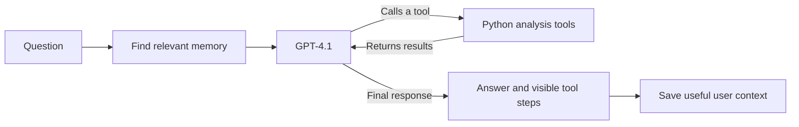

# BYTE into Data

I built **BYTE into Data** for the [AI Agent challenge](AI%20Agent%20requirements.txt). It started as a terminal project where the model had to call data tools before answering. I wanted to make that workflow easier to use: now I can drop a file into `data/` or upload it in the browser, ask a question, and see the actual analysis steps behind the answer.

The app uses **GPT-4.1** for the main conversation, with pandas, DuckDB, SciPy, scikit-learn, Matplotlib, and Seaborn for the analysis. I kept the seven original tools and added a web interface, saved chats, automatic memory, and token usage details.

## What you can do

- **Add a dataset without editing Python.** Files in `data/` are discovered automatically. The plus button in chat also uploads a file.
- **Ask questions in plain English.** The agent inspects columns and calls the right tool to calculate, query, test, or visualize the data.
- **See how an answer was made.** The collapsible Thinking section shows visible tool activity, while the final answer has its own space. It does not expose private model reasoning.
- **Continue a conversation.** Chats, uploaded files, charts, and useful memories persist in the app database.
- **Keep useful context.** The app can save definitions and preferences from normal conversation, select relevant memories for a later question, and let me edit them from the Memory icon.
- **Track API use.** The bar below chat shows input and output tokens, the latest prompt size against the GPT-4.1 context window, and the measured prompt cache hit rate.
- **Use your own API key.** GPT-4.1 can run with the workspace key or a key entered in the API key panel. The workspace key allows 10 prompts per browser; a personal key does not use that allowance.

The interface uses a dark black and gold theme. I designed it around the same workflow I use when exploring a new dataset: pick a file, ask a question, check the tool steps, and follow up.

## Try it locally

I used Python 3.12. Open PowerShell in the project folder:

```powershell
py -3.12 -m venv .venv
.\.venv\Scripts\python.exe -m pip install -r requirements.txt
Copy-Item .env.example .env
notepad .env
```

Put your OpenAI key in `.env` as `OPENAI_API_KEY`. You can also leave the workspace key unset and enter your own key in the web app. For a password protected local workspace, set `APP_PASSWORD` too. Then start the server:

```powershell
.\.venv\Scripts\python.exe -m uvicorn app:app --reload
```

Open **http://127.0.0.1:8000**. The terminal version is still available with `.\.venv\Scripts\python.exe core.py`.

On macOS or Linux, create the environment with `python3 -m venv .venv`, install with `.venv/bin/python -m pip install -r requirements.txt`, and run `.venv/bin/python -m uvicorn app:app --reload`.

## Add a dataset

Put a supported file into `data/` and refresh the Datasets list. The app also checks the folder before each question, so a new file does not need a code edit or server restart. The filename becomes a safe dataset and SQL table name: `Quarterly Sales.xlsx` becomes `quarterly_sales`. If two files produce the same name, the next one gets `_2`.

The plus button in chat and the Datasets panel upload files into the app database. Supported formats are **CSV, TSV, TXT, XLSX, XLS, XLSM, ODS, JSON, JSONL, NDJSON, Parquet, and Feather**. Excel loading currently uses the first sheet. Browser uploads are limited to 50 MB and use chunks for larger requests.

The repository includes Titanic and Melbourne housing CSVs for trying the project. For example:

> Inspect `titanic_dataset`. What columns have missing values?
>
> What was the survival rate by passenger class?
>
> Make a chart of passenger ages.

The agent gets the available dataset names with each question, so I can ask about a file I just added. It should use tool output for counts and calculations instead of guessing them.

## The seven analysis tools

| Tool | What I use it for |
| --- | --- |
| `inspect_dataset` | Check row count, columns, types, missing values, and sample rows. |
| `calculate` | Evaluate a restricted arithmetic expression. |
| `sql_query` | Query loaded tables with read only DuckDB SQL. |
| `statistical_test` | Run correlation, t-test, chi-square, ANOVA, IQR, z-scores, or a correlation matrix. |
| `generate_chart` | Create a histogram, scatter plot, bar chart, heatmap, and other charts. |
| `data_quality` | Check formatting issues and compare data for drift. |
| `forecast` | Find correlations or fit a linear regression. The name comes from the original project; it is not a time-series forecaster. |

The model receives the schemas in [json_schema.py](json_schema.py). [tool_usage_guide.md](tool_usage_guide.md) documents the arguments and examples. The agent calls a tool, reads its result, and can call another before writing the final answer. Chart images appear in the conversation when chart generation succeeds.

## How memory works

Memory is separate from chat history. After an answer, a small GPT-4.1-mini pass reviews the recent conversation and existing memories for reusable facts supplied by the user. It can save more than one item from a turn, even when I never type “remember.” Examples include a metric definition, a column meaning, a project detail, or a preference. A correction can update an earlier item.

Before a new answer, another pass chooses only memories relevant to that question. A fact can also be scoped to a dataset. I can inspect, add, edit, or delete memory entries with the **Memory** icon. Saved memory guides the agent; it does not replace evidence from the dataset tools.

For example, if I say “An active customer means someone who ordered in the last 30 days,” that definition can be saved. A later question about active customers can use it. If I change the definition to 60 days, I can correct it in chat or edit the saved entry directly.

## From a question to an answer



The app loads the available dataset names before a question. The model can inspect a dataset, call another tool with the exact columns it found, and then answer from the returned results. The Thinking panel shows those visible steps. A separate memory pass runs after the answer, so saved context is ready for a later conversation.

## How the app is put together

```text
app.py             FastAPI routes, sign-in, uploads, and streamed chat events
core.py            GPT-4.1 tool loop and terminal chat
datasets.py        Automatic folder discovery and uploaded dataset loading
memory.py          Automatic memory updates and relevant recall
storage.py         SQLite locally or Postgres on Railway
tools.py           Tabular file readers and the seven analysis tools
json_schema.py     Tool definitions sent to the model
usage.py           Token, context, and cache accounting
static/            Web interface
data/              Automatically discovered local datasets
tests/             Workflow checks
```

I wrote the tool loop, data loading, tool schemas, memory flow, storage layer, and web interface. OpenAI provides the models; the calculations run through the Python tools. Locally, SQLite keeps chats, uploads, charts, and memories in `app_state.sqlite3`. The old `agent_memory.json`, if present, is imported once.

The web app is a **single shared workspace** protected by `APP_PASSWORD`. It does not have separate user accounts. A signed browser cookie tracks the 10-prompt allowance for the workspace key. Clearing browser data creates a new browser identity, so this is a practical usage limit rather than a separate account system. A personal OpenAI key stays in the current browser tab's session storage, is sent through the app server for the request, and is not saved in the app database. The workspace API key stays on the server and is never displayed or sent to the browser.

## Deploy on Railway

The repository includes [railway.json](railway.json) to start the FastAPI server. To deploy it:

1. Create a Railway project from this GitHub repository.
2. Add a PostgreSQL service. In the app service, add a reference variable named `DATABASE_URL` pointing to the Postgres service's `DATABASE_URL`. The database keeps chats, memories, uploads, charts, and prompt counts across deploys.
3. Set `APP_PASSWORD` in the app service. Set `OPENAI_API_KEY` if you want to provide 10 workspace prompts per browser; otherwise, visitors can enter their own key in the app. `SESSION_SECRET` is an optional separate secret for signing cookies.
4. Generate a public domain from the app service's Networking settings. Open `/api/status` to check setup, then sign in and try an upload.

Files added to `data/` in the repository appear after a redeploy. For a live deployment, the browser uploader is the way to add a dataset immediately. Keep `.env`, database credentials, and API keys out of Git.

## Checks and next steps

I run the workflow tests with:

```powershell
.\.venv\Scripts\python.exe -m unittest discover -s tests -v
```

The tests cover dataset discovery and uploads, memory changes and selection, tool safety, API behavior, the workspace prompt limit, and token accounting. I also tested a real GPT-4.1 question against the included Titanic data: the agent inspected the dataset and returned its **891 rows** from the tool result.

Next I want to add Excel sheet selection, support for larger browser uploads, and separate accounts if the project grows beyond one workspace. Right now it gives me a complete flow from uploading a file to checking a grounded answer.
