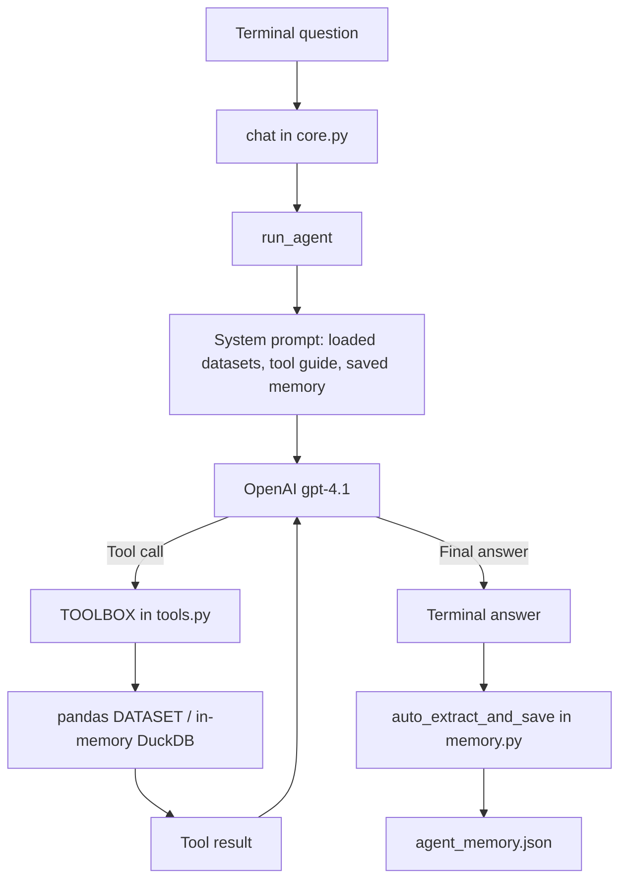

# Tabular Data Analysis Agent

I built this command-line data analysis agent for the **AI Agent challenge** in [AI Agent requirements.txt](AI%20Agent%20requirements.txt). I wanted it to answer questions by examining data and calling tools, instead of giving a plausible answer from the language model alone. The agent currently ships with two example datasets and seven different tools. I also experimented with memory that persists across runs.

The project uses Python, the OpenAI API (`gpt-4.1`), pandas, DuckDB, SciPy, scikit-learn, Matplotlib, and Seaborn. You need your **own OpenAI API key** to run it. No key is included in this repository.

## How this matches the challenge

| Challenge item | What I implemented |
| --- | --- |
| At least five genuinely different tools | Seven tools for inspection, arithmetic, SQL, statistical tests, charts, data quality, and regression. |
| Answer by analysing tabular data | The model can call the tools, read their returned results, and then answer. The system prompt instructs it to ground numbers in tool output. |
| Work with more than one dataset | `load_data()` handles CSV, TSV, TXT, Excel, JSON, and Parquet files. I included two datasets; adding another currently requires one line in `core.py`. |
| Explain the stack and my contribution | The sections below describe each module and what I built. |
| Optional persistent memory | Definitions and preferences can be saved in a local JSON file and reused in later sessions. This is an early version of the optional feature; it does not yet retrieve only relevant memories or offer memory management commands. |
| Public repository and README | This README includes setup, architecture, tool and memory details, examples, and limitations. A demo video or deployed version has not been added. |

## Project files

```text
.
├── AI Agent requirements.txt   # Original challenge brief
├── README.md                   # This guide
├── .env.example                # Safe template for local configuration
├── .gitignore                  # Excludes keys, local memory, and generated files
├── requirements.txt            # Pinned Python packages
├── core.py                     # Startup, model/tool loop, and terminal chat
├── tools.py                    # Data loading and seven tool implementations
├── json_schema.py              # Tool definitions supplied to the model
├── tool_usage_guide.md         # Detailed rules included in the system prompt
├── memory.py                   # Save and recall definitions/preferences
├── data/
│   ├── Titanic_Dataset.csv
│   └── Melbourne_housing_FULL.csv
└── output/                     # Charts are written here when generated
```

The local `.env` file and `agent_memory.json` are intentionally missing from the repository because `.gitignore` excludes them. The agent creates `agent_memory.json` when it saves a memory. Generated PNG charts under `output/` are also ignored.

## Setup on Windows (PowerShell)

1. Install Python 3.12 and make sure the `py` launcher works. Open PowerShell in this project folder.
2. Create a virtual environment and install the pinned packages:

   ```powershell
   py -3.12 -m venv .venv
   .\.venv\Scripts\python.exe -m pip install -r requirements.txt
   ```

3. Create your private environment file from the template:

   ```powershell
   Copy-Item .env.example .env
   notepad .env
   ```

   Replace `replace_with_your_own_api_key` in `.env` with your key. The variable must be named **`OPENAI_API`**, because that is what `core.py` reads. Keep `.env` private and do not paste your key into source code, screenshots, or GitHub. OpenAI API usage can incur charges.

4. Run from the project folder:

   ```powershell
   .\.venv\Scripts\python.exe core.py
   ```

The two bundled CSVs load when `core.py` starts. The terminal prints their dataset names, then waits for a question. After each answer it asks whether you want to continue. The paths in the program are relative, so run the command **from this folder**.

On macOS or Linux, use `python3 -m venv .venv`, `.venv/bin/python -m pip install -r requirements.txt`, and `.venv/bin/python core.py`. Create `.env` by copying `.env.example`.

## Example questions

- “Inspect the Titanic dataset. What columns and missing values does it have?”
- “What is the survival rate for each `Pclass` in `titanic`?”
- “Is `Age` correlated with `Fare` in `titanic`?”
- “Make a histogram of passenger ages.”
- “Check the Melbourne housing data for formatting problems.”
- “Use a linear regression to estimate `Fare` from `Age` and `Pclass`.”
- “If I define a wealthy traveler as `Pclass = 1 AND Fare > 100`, how many wealthy travelers are in Titanic?”

The exact loaded names are `titanic` and `melbourne_housing_full`. The Titanic file has 891 rows and 12 columns; the Melbourne housing file has 34,857 rows and 21 columns. The model should inspect a dataset before using column names, then use a calculation or data tool to support its answer. Chart files appear in `output/`; the terminal prints their paths.

## The seven tools

The model sees the tool signatures from `json_schema.py`. `core.py` maps each tool name to a Python function in `tools.py` through `TOOLBOX`.

| Model tool | Python function | What it does |
| --- | --- | --- |
| `inspect_dataset` | `inspect_data` | Returns row count, data types, missing-value counts, summary statistics, and the first five rows. This helps the model learn exact column names. |
| `calculate` | `calculate` | Evaluates a math expression using arithmetic and Python `math` functions. It does not read a dataset. |
| `sql_query` | `safe_sql_query` | Queries loaded tables with DuckDB. It accepts a statement starting with `SELECT` or `WITH` and shows up to 50 result rows. |
| `statistical_test` | `statistical_test` | Runs correlation, two-sample t-test, chi-square, ANOVA, z-scores, IQR, or a correlation matrix. |
| `generate_chart` | `visualize_data` | Saves a PNG chart: scatter, line, bar, histogram, bell curve, box, violin, pie, area, heatmap, or regression plot. |
| `data_quality` | `data_quality_check` | Looks for formatting issues or compares datasets/chunks for drift. It reports issues without changing the source data. |
| `forecast` | `regression_tool` | Finds strong correlations or fits a linear regression for a numeric target, with optional prediction for one new row. Despite its name, it is **not** a time-series forecaster. |

For the full argument rules and examples, see [tool_usage_guide.md](tool_usage_guide.md). The program loads this file into the system prompt, so the model receives the same tool instructions. One practical limit is that long tool results are shortened to 8,000 characters before they go back to the model; SQL displays at most 50 rows.

## Architecture: how a question is answered



When the program starts, the `load_data(...)` calls at the top of `core.py` read both example files into the `DATASET` dictionary and register them as DuckDB tables. `chat()` then reads a question from the terminal. `run_agent()` builds a system prompt with the dataset names, `tool_usage_guide.md`, and saved memory. It adds the previous user/assistant turns and sends the messages plus seven tool schemas to `gpt-4.1`.

If the model asks for a tool, `run_agent()` parses its JSON arguments, executes the matching function from `TOOLBOX`, appends the returned text, and calls the model again. It stops when the model gives a final answer or reaches the eight-step limit. `chat()` prints that answer, tries to save any reusable memory from the turn, and adds the clean user/assistant messages to the in-session conversation history.

The dataset tables are **in memory** for the running process. They are loaded again on the next run. The chat history is also in memory for only the current run. The separate memory JSON file is what can survive a restart.

## Using another dataset

`load_data()` supports `.csv`, `.txt`, `.tsv`, `.xlsx`, `.xls`, `.json`, and `.parquet`. Put your file in `data/`, then add a top-level line beside the existing examples in `core.py`:

```python
load_data("data/sales.csv", "sales")
```

Now you can ask about the `sales` dataset, and its SQL table name is also `sales`. If you leave out the second argument, the table name is derived from the filename and cleaned for SQL. You can remove the two example `load_data(...)` lines if you want to run only your data. At present there is no interactive file upload or command-line dataset argument; registering a new file requires editing these startup lines. Do not commit a private dataset to a public repository.

## Memory: what works now

I added memory in `memory.py` to try the challenge's optional mission. After each answer, `chat()` calls `auto_extract_and_save(user_question, agent_answer, client)`. This makes **an additional `gpt-4.1` API call** asking whether that turn contains one reusable definition, filter, column meaning, or preference. If it gets a valid item, `remember()` writes it to the local `agent_memory.json` file under `definitions` or `preferences` and prints `[Persistent Memory Updated]`.

For example, telling the agent “For this analysis, wealthy traveler means `Pclass = 1 AND Fare > 100`” may save a definition. On the next question or the next program run, `format_memory_for_prompt()` reads the JSON file and places the saved definition in the system prompt. At startup, `chat()` also prints any saved definitions and preferences, which is a quick way to check that the file was read.

This is different from normal chat history: chat history contains the conversation from the current run and disappears when the program exits; `agent_memory.json` stays on your computer. It is ignored by Git, so someone who clones this repository starts with empty memory.

To check memory in three stages: (1) state a reusable definition and look for `[Persistent Memory Updated]` plus a new entry in `agent_memory.json`; (2) restart `core.py` and check that the definition appears under “REMEMBERED FROM EARLIER SESSIONS”; (3) ask a question using that definition and inspect the printed tool call to see whether the model actually included the saved condition. The first stage tests extraction, the second tests persistence, and the third tests whether memory changed the analysis. Passing one stage does not guarantee the next one.

### Why memory may appear not to work

- A fact is saved only if the second model call detects it and returns valid JSON. Ordinary questions usually create no memory. Extraction errors are currently caught without an error message.
- The code inserts **all** saved definitions and preferences into each new system prompt. It does not search for the most relevant fact or link a fact to a specific dataset.
- A saved fact is guidance for the model; there is no code that automatically turns a definition into a SQL filter. The model still has to choose to apply it correctly.
- Saving another item with the exact same category and key (case-insensitive) overwrites the old value. There is no deeper stale-fact or contradiction check.
- There is no user command such as `show memory`, `forget`, or `correct`. To inspect local state, open `agent_memory.json` in an editor. It is a JSON object with `definitions` and `preferences`; you can edit or remove entries while the program is stopped.
- If `agent_memory.json` is malformed or cannot be read, `load_memory()` currently falls back to empty memory without showing the reason.
- The extractor can save a category other than `definitions` or `preferences`, but the prompt formatter only reads those two categories. Such an entry would stay in the JSON file without being used.

These are the main gaps between this first version and the challenge's stronger memory goal of **relevant retrieval, reliable updates, conflict handling, and user control**. I would address them next with explicit memory commands, dataset-scoped facts, retrieval based on the current question, and tests that show a saved definition changes a later SQL query.

## What I built and what I would improve

My contribution was connecting the model's tool-calling loop to seven analysis functions, defining the tool schemas and detailed usage guide, loading datasets into pandas and DuckDB, adding the terminal chat, and trying a persistent definition/preference store. I used the libraries listed in `requirements.txt` and the OpenAI `gpt-4.1` model; the model itself is provided by OpenAI.

This is a learning project, with some important limits:

- The program currently starts with two fixed example file paths. Loading a different file needs a code edit and a restart.
- The memory feature persists facts but does not yet meet the full optional memory mission described above.
- The system prompt and full conversation history are sent again for each question, which can increase token usage over a long session.
- Chart images are saved locally, but the model only receives the path and cannot inspect the image it generated.
- The SQL tool checks for a `SELECT`/`WITH` prefix, but that check should not be treated as a complete security boundary for untrusted SQL. The math tool uses Python `eval` with restricted built-ins; I would replace it with a small expression parser before exposing this as a public service.
- The agent asks the API for one tool call at a time, but its current loop only appends the last result if a response unexpectedly contains multiple tool calls.
- There are no automated end-to-end tests in this repository yet. I would add tests for new dataset loading, each tool, and cross-session memory behavior.

For a challenge demo, I would run several questions that require different tools, show the tool calls printed in the terminal, then add a new suitable dataset and repeat. For memory, I would show the saved JSON entry, restart the program, and ask a question where the saved definition needs to change the analysis. A short screen recording of that flow would meet the challenge's preferred demo format.

## Keeping the repository safe

`.gitignore` excludes `.env`, local virtual environments, `agent_memory.json`, Python cache files, and generated chart PNGs. `.env.example` contains only a placeholder and is safe to commit. Before pushing to a public repository, check the files staged by Git and make sure they contain no keys or private datasets. If a real key has ever been pushed to any repository, remove it from the provider account and create a new one; deleting the file from a later commit is not enough.

The included CSVs are examples, but their exact download source and redistribution terms are not recorded in this project. Before publishing those files, I would confirm their source and license and add attribution here. That check is separate from the API-key check.
