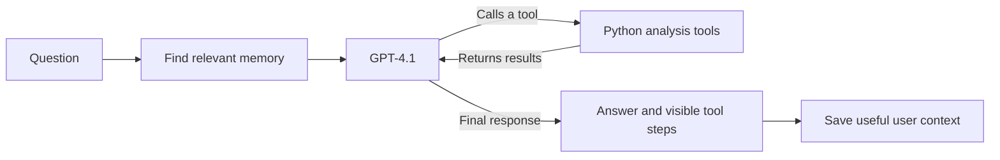
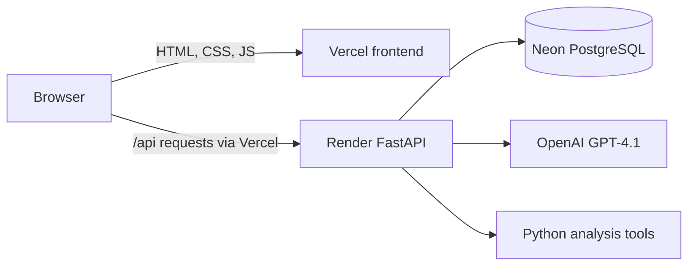

# BYTE into Data

I built **BYTE into Data** for the [AI Agent challenge](AI%20Agent%20requirements.txt). It started as a terminal project where the model had to call data tools before answering. I wanted to make that workflow easier to use: now I can drop a file into `data/` or upload it in the browser, ask a question, and see the actual analysis steps behind the answer.

The app uses **GPT-4.1** for the main conversation, with pandas, DuckDB, SciPy, scikit-learn, Matplotlib, and Seaborn for the analysis. I kept the seven original tools and added a web interface, saved chats, automatic memory, and token usage details.

## What you can do

- **Add a dataset without editing Python.** Files in `data/` are discovered automatically. The plus button or dropping a file over chat also uploads it.
- **Ask questions in plain English.** The agent inspects columns and calls the right tool to calculate, query, test, or visualize the data.
- **See how an answer was made.** The collapsible Thinking section shows visible tool activity, while the final answer has its own space. It does not expose private model reasoning.
- **Continue a conversation.** Chats, uploaded files, charts, and useful memories persist in the app database.
- **Keep useful context.** The app can save definitions and preferences from normal conversation, select relevant memories for a later question, and let me edit them from the Memory icon.
- **Track API use.** The bar below chat shows input and output tokens, the latest prompt size against the GPT-4.1 context window, and the measured prompt cache hit rate.
- **Use your own API key.** GPT-4.1 can run with the workspace key or a key entered in the API key panel. The workspace key allows 10 prompts per browser; a personal key does not use that allowance.

The interface uses a dark black and gold theme. I designed it around the same workflow I use when exploring a new dataset: pick a file, ask a question, check the tool steps, and follow up.

## Try it locally

I used Python 3.12. Open PowerShell in the project folder:

```powershell
py -3.12 -m venv .venv
.\.venv\Scripts\python.exe -m pip install -r requirements.txt
Copy-Item .env.example .env
notepad .env
```

Put your OpenAI key in `.env` as `OPENAI_API_KEY`. You can also leave the workspace key unset and enter your own key in the web app. For a password protected local workspace, set `APP_PASSWORD` too. Then start the server:

```powershell
.\.venv\Scripts\python.exe -m uvicorn app:app --reload
```

Open **http://127.0.0.1:8000**. The terminal version is still available with `.\.venv\Scripts\python.exe core.py`.

On macOS or Linux, create the environment with `python3 -m venv .venv`, install with `.venv/bin/python -m pip install -r requirements.txt`, and run `.venv/bin/python -m uvicorn app:app --reload`.

## Add a dataset

Put a supported file into `data/` and the open web app picks it up within about 15 seconds. It also checks the folder before each question, so a new file does not need a code edit or server restart. The filename becomes a safe dataset and SQL table name: `Quarterly Sales.xlsx` becomes `quarterly_sales`. If two files produce the same name, the next one gets `_2`.

The plus button in chat and the Datasets panel upload files into the app database. Supported formats are **CSV, TSV, TXT, XLSX, XLS, XLSM, ODS, JSON, JSONL, NDJSON, Parquet, and Feather**. Excel loading currently uses the first sheet. Browser uploads are limited to 50 MB and use chunks for larger requests.

The repository includes Titanic and Melbourne housing CSVs for trying the project. For example:

> Inspect `titanic_dataset`. What columns have missing values?
>
> What was the survival rate by passenger class?
>
> Make a chart of passenger ages.

The agent gets the available dataset names with each question, so I can ask about a file I just added. It should use tool output for counts and calculations instead of guessing them.

## The seven analysis tools

| Tool | What I use it for |
| --- | --- |
| `inspect_dataset` | Check row count, columns, types, missing values, and sample rows. |
| `calculate` | Evaluate a restricted arithmetic expression. |
| `sql_query` | Query loaded tables with read only DuckDB SQL. |
| `statistical_test` | Run correlation, t-test, chi-square, ANOVA, IQR, z-scores, or a correlation matrix. |
| `generate_chart` | Create a histogram, scatter plot, bar chart, heatmap, and other charts. |
| `data_quality` | Check formatting issues and compare data for drift. |
| `forecast` | Find correlations or fit a linear regression. The name comes from the original project; it is not a time-series forecaster. |

The model receives the schemas in [json_schema.py](json_schema.py). [tool_usage_guide.md](tool_usage_guide.md) documents the arguments and examples. The agent calls a tool, reads its result, and can call another before writing the final answer. Chart images appear in the conversation when chart generation succeeds.

## How memory works

Memory is separate from chat history. After an answer, a small GPT-4.1-mini pass reviews the recent conversation and existing memories for reusable facts supplied by the user. It can save more than one item from a turn, even when I never type “remember.” Examples include a metric definition, a column meaning, a project detail, or a preference. A correction can update an earlier item.

Before a new answer, another pass chooses only memories relevant to that question. A fact can also be scoped to a dataset. I can inspect, add, edit, or delete memory entries with the **Memory** icon. Saved memory guides the agent; it does not replace evidence from the dataset tools.

For example, if I say “An active customer means someone who ordered in the last 30 days,” that definition can be saved. A later question about active customers can use it. If I change the definition to 60 days, I can correct it in chat or edit the saved entry directly.

## From a question to an answer



The app loads the available dataset names before a question. The model can inspect a dataset, call another tool with the exact columns it found, and then answer from the returned results. The Thinking panel shows those visible steps. A separate memory pass runs after the answer, so saved context is ready for a later conversation.

## How the app is put together

```text
app.py             FastAPI routes, sign-in, uploads, and streamed chat events
core.py            GPT-4.1 tool loop and terminal chat
datasets.py        Automatic folder discovery and uploaded dataset loading
memory.py          Automatic memory updates and relevant recall
storage.py         SQLite locally or Postgres online
tools.py           Tabular file readers and the seven analysis tools
json_schema.py     Tool definitions sent to the model
usage.py           Token, context, and cache accounting
static/            Web interface
data/              Automatically discovered local datasets
tests/             Workflow checks
```

I wrote the tool loop, data loading, tool schemas, memory flow, storage layer, and web interface. OpenAI provides the models; the calculations run through the Python tools. Locally, SQLite keeps chats, uploads, charts, and memories in `app_state.sqlite3`. The old `agent_memory.json`, if present, is imported once.

The web app is a **single shared workspace** protected by `APP_PASSWORD`. It does not have separate user accounts. A signed browser cookie tracks the 10-prompt allowance for the workspace key. Clearing browser data creates a new browser identity, so this is a practical usage limit rather than a separate account system. A personal OpenAI key stays in the current browser tab's session storage, is sent through the app server for the request, and is not saved in the app database. The workspace API key stays on the server and is never displayed or sent to the browser.

## Why I split the website across Vercel and Render

The browser interface is plain HTML, CSS, and JavaScript. It can be served as static files without installing pandas or running Python. The analysis API needs Python, the data libraries, OpenAI calls, and a database. I put those jobs on separate hosts:

| Part | Where it runs | Why |
| --- | --- | --- |
| Chat interface | Vercel | Serves the small static files quickly. I can change the layout without turning the browser into a Python app. |
| Analysis API | Render | Runs FastAPI, GPT-4.1 tool calls, dataset readers, chart generation, and memory updates. |
| Saved data | Neon PostgreSQL | Keeps chats, uploads, memories, charts, and prompt counts when the API restarts. |

The frontend calls `/api/...` on its own Vercel address. A Vercel rewrite forwards that path to the Render API. This keeps requests on one browser origin, so sign-in cookies and the upload button work in the same way as they do locally. The OpenAI workspace key belongs in Render's private environment settings; it never belongs in the frontend files or Vercel's static output.



I kept the same web files in `static/` for local development. FastAPI serves them locally; Vercel publishes them for the hosted site. The Python API stays one codebase in both places. I used CSS and small, dependency-free JavaScript for the interface so the frontend is easy to inspect and adjust.

## Deploy the same setup

The hosting services read this GitHub repository. I use Python 3.12, which is pinned in [.python-version](.python-version), and keep credentials out of Git. The order matters: get the Render API address first, then point Vercel's `/api` rewrite at it.

### 1. Prepare the database

I used **Neon PostgreSQL** through the Vercel Marketplace. In Vercel, open **Marketplace → Neon → Install**. Select the personal workspace, create the free Neon account, choose a database region near the Render service, and select the **Free** plan. I named the resource `byte-into-data-db` and chose Portland because the Render service is in Oregon. Neon Auth and Realtime are off because this app has its own workspace password and does not use those features.

After Neon provisions the database, skip **Connect a Project**. The Vercel project serves only public static files and does not need database credentials. In the Neon resource dashboard, copy the pooled PostgreSQL connection URL into Render's private `DATABASE_URL` setting. Do not put that URL in Git, `vercel.json`, or frontend JavaScript. The app creates its tables automatically on first use.

This separate database matters because [Render's free web service filesystem is temporary](https://render.com/docs/free). A local SQLite file or uploaded file there disappears after a restart or redeploy. Neon keeps the uploaded datasets and saved conversations in PostgreSQL. The free Neon plan currently includes [1 GB storage and 100 CU-hours per project each month](https://neon.com/blog/neon-free-plan-1-gb-per-project); check the plan page if you repeat these steps later.

### 2. Deploy the Python API on Render

1. In Render, choose **New → Web Service** and connect this GitHub repository. Give Render access to this repo if it asks.
2. Choose the `main` branch and Python runtime. The build command is `pip install -r requirements.txt`; the start command is `uvicorn app:app --host 0.0.0.0 --port $PORT`. [render.yaml](render.yaml) records these settings.
3. Set `DATABASE_URL` and a private `APP_PASSWORD` in the service's Environment page. Set `OPENAI_API_KEY` there if you want to offer the ten shared prompts. `SESSION_SECRET` can be set to a separate random value for cookie signing.
4. Deploy and open `https://YOUR-RENDER-URL/api/status`. It should say `"ready": true`. The service's root page also works, but I use the Vercel address as the public site.

The server never returns the workspace API key to the browser. If it is missing, users can still enter their own key in the app. The API requires a database and workspace password in production so it will not quietly start with temporary local state.

### 3. Deploy the frontend on Vercel

1. Put the actual Render URL in the `/api/:path*` rewrite in [vercel.json](vercel.json), commit it, and push it to GitHub. The other rewrite maps `/static/...` assets to Vercel's published static directory.
2. In Vercel, import the same GitHub repository as a project. Use the **Other** framework preset. The output directory is `static`, as recorded in `vercel.json`; Vercel publishes `index.html`, CSS, JavaScript, and the favicon.
3. Deploy and open the Vercel URL. The browser talks to Vercel, Vercel forwards API requests to Render, and Render reads and writes PostgreSQL. No OpenAI key is needed in Vercel's environment settings.
4. Check sign-in, one dataset upload, a question, Thinking steps, saved chat, memory editing, and the usage bar. Open the page at phone width too.

Files committed to `data/` appear online after a redeploy. For an immediate new dataset, use the plus button in the browser. A [free Render service sleeps after 15 minutes without traffic](https://render.com/docs/free), so the first request after a quiet period can take about a minute. Keep `.env`, database credentials, passwords, and API keys out of Git.

## If I were building this again

I would start with one working data tool and make the model use its returned result. Then I would add file discovery and stable dataset names, the remaining tools, and tests for bad file types and unsafe queries. After that I would add persistent chats and memory, with a separate memory selection step so old context is used only when it helps. Finally I would build the chat interface, expose token usage from actual API responses, and split the static frontend from the Python backend for deployment. That order kept each change testable before I added the next part.

## Checks and next steps

I run the workflow tests with:

```powershell
.\.venv\Scripts\python.exe -m unittest discover -s tests -v
```

The tests cover dataset discovery and uploads, memory changes and selection, tool safety, API behavior, the workspace prompt limit, and token accounting. I also tested a real GPT-4.1 question against the included Titanic data: the agent inspected the dataset and returned its **891 rows** from the tool result.

Next I want to add Excel sheet selection, support for larger browser uploads, and separate accounts if the project grows beyond one workspace. Right now it gives me a complete flow from uploading a file to checking a grounded answer.
